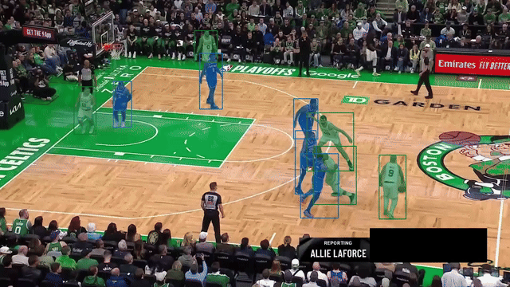
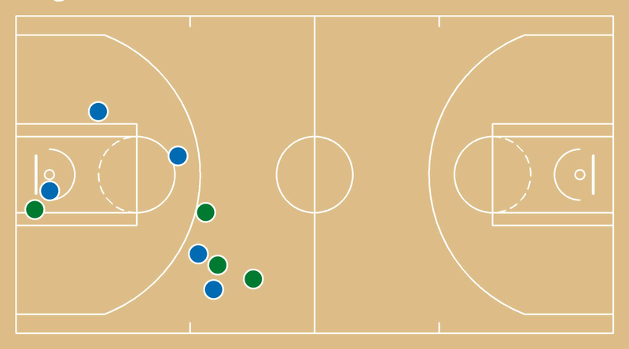

# Basketball player tracking

Computer-vision pipeline for NBA broadcast footage: player / ball / rim detection, SAM2 tracking, team classification, court homography and shot detection, with the end goal of feeding a game-intelligence dashboard.

> **Status:** work in progress. The current baseline assumes a **continuous shot with all 10 players visible on the first frame**. Cut handling, re-identification across cuts and jersey-number OCR are implemented but disabled (see [Roadmap](#roadmap)).

<p align="center">
  
  
</p>

## Pipeline

```
video ──► detection (RF-DETR, Roboflow) ──► SAM2 tracking (seeded once on frame 0)
              │                                   │
              │                                   ├──► team classifier (SigLIP + UMAP + KMeans, k=2, CPU)
              │                                   └──► court keypoints + homography ──► court (x, y)
              └──► shot detection (jump shot / layup / ball-in-basket) ──► shots + shot map
```


| Brick                | File               | Model / method                                                                          |
| -------------------- | ------------------ | --------------------------------------------------------------------------------------- |
| Detection            | `src/detection.py` | `basketball-player-detection-3-ycjdo/4` + per-class filtering, referee suppression, NMS |
| Tracking             | `src/tracking.py`  | SAM2.1 hiera tiny, real-time camera-predictor fork                                      |
| Teams                | `src/teams.py`     | `sports.TeamClassifier`, fitted once, then predict only                                 |
| Court keypoints      | `src/keypoints.py` | `basketball-court-detection-2/14` + `sports.ViewTransformer`                            |
| Shots                | `src/shots.py`     | event classes from the detector, made/missed, position projected on court               |
| OCR (off by default) | `src/ocr.py`       | `basketball-jersey-numbers-ocr/7`, not loaded when disabled                             |


## Requirements

- Python 3.11.9
- NVIDIA GPU with a driver supporting CUDA 12.6 or newer (developed on a laptop RTX 3050, 4 GB VRAM). The PyTorch `cu126` wheels ship their own CUDA runtime, so no separate CUDA Toolkit install is needed.
- A [Roboflow](https://roboflow.com) API key
- Developed on Windows; commands below use the Windows venv layout


## Installation

```bash
git clone https://github.com/ZoukaB/Basketball-player-tracking.git
cd Basketball-player-tracking
python -m venv .venv
.venv\Scripts\activate
pip install torch==2.14.0 torchvision==0.29.0 --index-url https://download.pytorch.org/whl/cu126
pip install -r requirements.txt   # or requirements-notebooks.txt to also run the notebooks
```

Check that PyTorch sees the GPU: `python -c "import torch; print(torch.__version__, torch.cuda.is_available())"` should print `2.14.0+cu126 True`.

**SAM2 real-time fork.** Clone it **next to** this repo (the path is set by `sam2.repo_dir` in `src/config.yaml`) and download the checkpoints:

```bash
cd ..
git clone https://github.com/Gy920/segment-anything-2-real-time.git
cd segment-anything-2-real-time/checkpoints
curl -O https://dl.fbaipublicfiles.com/segment_anything_2/092824/sam2.1_hiera_tiny.pt
```

The fork does not need to be pip-installed: `src/tracking.py` imports it directly from `sam2.repo_dir`, and its dependencies (`hydra-core`, `iopath`) are in `requirements.txt`. Only the tiny checkpoint is used.

**Roboflow key.** Create a `.env` file at the repo root:

```
ROBOFLOW_API_KEY=your_key_here
```

**SigLIP weights.** The pipeline runs Hugging Face in offline mode (`HF_HUB_OFFLINE=1`), so the SigLIP model used by the team classifier must be cached once. Run any script a first time with `HF_HUB_OFFLINE=0` set in your environment.

## Usage

Put your clip in `data/` (videos are git-ignored) and point `input.video` in `src/config.yaml` to it. Then, from the repo root:

```bash
python src/run.py
```

Outputs are written to `outputs/`:


| File            | Content                                                      |
| --------------- | ------------------------------------------------------------ |
| `annotated.mp4` | masks and boxes coloured by team, track IDs, court keypoints |
| `tracks.csv`    | `frame, track_id, team, x1, y1, x2, y2, court_x, court_y`    |
| `shots.json`    | shooter, team, court position, made/missed                   |
| `shot_map.png`  | half-court diagram, made (o) / missed (x) per team           |


The script also prints per-brick timing (ms/frame) and peak VRAM.

**Shot collection over many possessions** (no SAM2, detection + homography only), using `input.video_dir`:

```bash
python src/collect_shots.py --limit 3 --max-seconds 10
```

**Per-brick smoke tests** (each writes debug outputs to `outputs/<video stem>/`):

```bash
python tests/test_detection.py --seconds 8
python tests/test_tracking.py --start 6 --seconds 4
python tests/test_teams.py
python tests/test_keypoints.py
python tests/test_shots.py
python tests/test_ocr.py --enabled
```


## Configuration

Everything lives in `src/config.yaml`: model IDs, thresholds, analysis fps, team names / colours / rosters, feature flags (`ocr.enabled`, `render.annotated_video`, `render.court_keypoints`). Team names and rosters are currently set for Celtics vs Knicks.

## Known limitations

- Players who enter the frame after the first frame are not tracked (`sam2.reprompt_policy: never`).
- No cut handling in `run.py`: on edited broadcast footage, run one clip per possession.
- The team cluster index → team name mapping can flip between runs.
- Speed: SAM2-tiny is the main cost (~2.6 s/frame on an RTX 3050).


## Roadmap

See `[notes/future_ideas.md](notes/future_ideas.md)`: re-prompting policies, OCR-based ID reconciliation across cuts, team-label stabilisation, speed-ups, better foot-point homography.

## Credits

Built on Roboflow's `[sports](https://github.com/roboflow/sports)` library and their basketball tutorial notebook (`notebooks/basketball-ai-how-to-detect-track-and-identify-basketball-players.ipynb`), and on the SAM2 real-time fork of Meta's [Segment Anything 2](https://github.com/facebookresearch/sam2).
